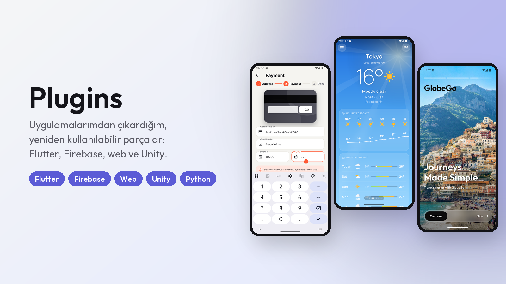

# Plugins

Projelerimden çıkardığım, bağımsız ve yeniden kullanılabilir eklentiler ve şablonlar. Her eklentinin kendi README'si var: ne işe yaradığı, nasıl eklendiği ve örnek kod.

🇬🇧 [English](#-english)

---

| Klasör | İçerik |
|---|---|
| 📱 [`mobile/`](mobile/) | Flutter / Dart: arayüz ve hareket, ödeme, randevu, sohbet, önbellek, gökyüzü, görüntü işleme |
| 🌐 [`web/`](web/) | JavaScript / TypeScript: sayfa düzenleyici, 3B küre, tarayıcı yardımcıları, depo, WhatsApp botu, NestJS kimlik doğrulama |
| 🎮 [`game/`](game/) | Unity (C#) betikleri ve tahmin oyunu motoru (JS + Kotlin) |
| 🛠️ [`tools/`](tools/) | Tasarım karşılaştırma, emülatör otomasyonu, README görselleri (Python) |

## 📱 Mobil (Flutter / Dart)

Altı Flutter uygulamamdan çıkarıldı. Dart dosyalarının hepsi `flutter analyze` ile temiz ve testli; kopyalayıp projene ekleyebilirsin.

| Eklenti | Ne işe yarar | Kaynak uygulama |
|---|---|---|
| [flutter-motion-kit](mobile/flutter-motion-kit/) | **Kaydırarak onayla** düğmesi, basınca küçülen kartlar, sırayla beliren listeler, buzlu cam, yükleniyor iskeleti, boş/hata ekranı | [GlobeGo](https://github.com/SafaSenturk/flutter-travel-app-ui), [NovaShop](https://github.com/SafaSenturk/flutter-ecommerce-app) |
| [flutter-payment-card](mobile/flutter-payment-card/) | Luhn, marka tespiti, son kullanma ve CVV doğrulama, yazarken biçimleme, CVV'de dönen animasyonlu kart | [NovaShop](https://github.com/SafaSenturk/flutter-ecommerce-app) |
| [booking-slots](mobile/booking-slots/) | Çift rezervasyonu imkânsız kılan müsaitlik hesabı + Firestore transaction'ı + güvenlik kuralları | [Glow Studio](https://github.com/SafaSenturk/flutter-booking-app) |
| [firestore-chat-kit](mobile/firestore-chat-kit/) | Gerçek zamanlı sohbetin veri katmanı: okundu, yazıyor, tepki, düzenle/sil, güvenlik kuralları, bildirim fonksiyonu | [Pulse](https://github.com/SafaSenturk/flutter-firebase-chat) |
| [flutter-offline-cache](mobile/flutter-offline-cache/) | API yanıtları için önce çevrimdışı önbellek: internet yokken son veriyi "çevrimdışı" işaretiyle verir | [Atmos](https://github.com/SafaSenturk/flutter-weather-app) |
| [flutter-weather-sky](mobile/flutter-weather-sky/) | Havaya ve gece/gündüze göre hareketli gökyüzü, elle çizilmiş hava ikonları, WMO kodları | [Atmos](https://github.com/SafaSenturk/flutter-weather-app) |
| [flutter-image-filters](mobile/flutter-image-filters/) | Saf Dart ile Otsu, uyarlamalı eşik, Sobel, histogram eşitleme, konvolüsyon (OCR öncesi belge temizleme) | [Vision Lab](https://github.com/SafaSenturk/flutter-ai-vision-app) |

## 🌐 Web (JavaScript / TypeScript)

| Eklenti | Ne işe yarar | Kaynak proje |
|---|---|---|
| [page-editor](web/page-editor/) | Blok tabanlı görsel sayfa düzenleyici; sürükle-bırak, yerinde yazma, tema, TR/EN, yayınla + geçmiş | delamour |
| [orb3d](web/orb3d/) | Hareketli 3B tel kafes nesneler ve kıtalı dünya küresi; sürükle, şehir işaretleri, yaylar, kaydırma efekti | portföy |
| [web-utils](web/web-utils/) | `esc`, `slugify`, `money`/`parseNum` (TR), görsel küçültme, toast, güvenli localStorage | delamour |
| [persistent-store](web/persistent-store/) | localStorage'a kaydedilen dinlenebilir depo + hazır sepet/favoriler + React kancası | ecommerce-saas |
| [whatsapp-bot-kit](web/whatsapp-bot-kit/) | Evolution API istemcisi, webhook ayrıştırıcı, Gemini ile işletme adına cevap | [whatsapp-ai-asistan](https://github.com/SafaSenturk/whatsapp-ai-asistan) |
| [nestjs-jwt-auth](web/nestjs-jwt-auth/) | NestJS kayıt/giriş, JWT, rol koruması, şifre değiştirme | ecommerce-backend |

## 🎮 Oyun (Unity / C#, Kotlin)

| Eklenti | Ne işe yarar |
|---|---|
| [unity-ui-kit](game/unity-ui-kit/) | Kodla kurulan arayüz: paneller, butonlar, sekmeler, barlar. Sprite/prefab gerekmez |
| [unity-pause-menu](game/unity-pause-menu/) | Esc ile duraklatma menüsü; kaydet/yükle/ek buton bağlanır (ui-kit gerekir) |
| [unity-fps-controller](game/unity-fps-controller/) | Birinci şahıs yürüme, koşma, zıplama, fareyle bakış |
| [unity-procedural-audio](game/unity-procedural-audio/) | Ses dosyası olmadan kodla üretilen efektler ve kalabalık alkışı |
| [unity-foot-grounder](game/unity-foot-grounder/) | Humanoid karakterlerin yere gömülmesini/havada süzülmesini engeller |
| [guess-game-engine](game/guess-game-engine/) | Loldle/Wordle tarzı tahmin oyunu motoru (JS + Kotlin), günlük mod, paylaşım metni ([gamedle](https://github.com/SafaSenturk/gamedle)) |

Unity eklentilerinin hepsi SupermarketOyunu'ndan çıkarıldı. Input System ile de eski Input Manager ile de çalışırlar.

## 🛠️ Araçlar (Python)

| Araç | Ne işe yarar |
|---|---|
| [flutter-dev-tools](tools/flutter-dev-tools/) | Tasarımla piksel karşılaştırma, emülatör otomasyonu, README banner'ı, uygulama simgesi; altı Flutter uygulamamın vitrini bunlarla hazırlandı |

---

## 🇬🇧 English

Standalone, reusable plugins and templates taken from my projects, grouped by category. Every plugin has its own README with what it does, how to add it and example code (Turkish first, English below).

| Folder | Contents |
|---|---|
| 📱 [`mobile/`](mobile/) | **Flutter / Dart**, taken from my six Flutter apps, analyzed and tested: slide-to-confirm and motion widgets, payment card validation with a flipping card, double-booking-proof booking slots, a Firestore chat kit, an offline-first cache, an animated weather sky, image filters |
| 🌐 [`web/`](web/) | **JavaScript / TypeScript**: page editor, 3D globe, browser utilities, persistent store, WhatsApp bot kit, NestJS JWT auth |
| 🎮 [`game/`](game/) | **Unity (C#)**: code-built UI kit, pause menu, FPS controller, procedural audio, foot grounder; plus a Wordle-style guessing-game engine (JS + Kotlin) |
| 🛠️ [`tools/`](tools/) | **Python**: pixel comparison with a design, emulator automation, README banners, launcher icons |
